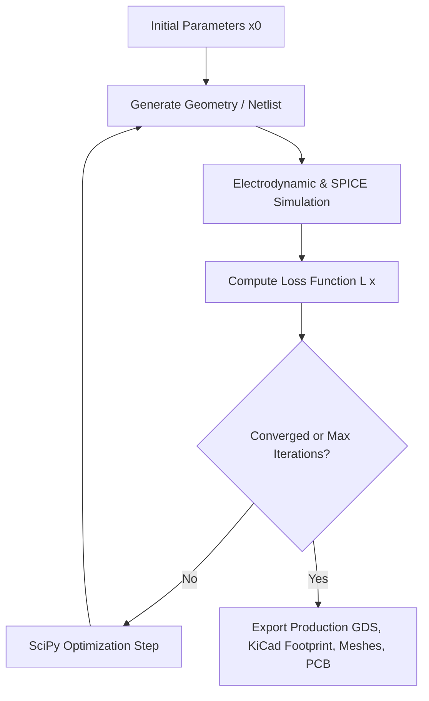

# 01 — Closed-Loop EDA & RF Optimization Architecture

This guide details the closed-loop optimization philosophy, cost function construction, and iteration lifecycle implemented in `src/loop/optimizer.py`.

---

## 1. The Closed-Loop Philosophy

Traditional hardware engineering relies on humans manually adjusting schematic component values or dragging copper trace vertices in a GUI layout tool, followed by tedious manual re-simulation.

In this autonomous workspace, an agent executes an iterative feedback loop:
1. **Hypothesize**: Choose physical parameters $\vec{x} = [w_1, l_1, w_2, l_2, \dots]$.
2. **Synthesize**: Generate physical layouts via `src/cad/rf_parametric.py` and electrical netlists.
3. **Simulate**: Compute frequency-domain S-parameters via `src/sim/rf_analytical.py` or 3D full-wave fields.
4. **Evaluate**: Score the design using a scalar loss function $L(\vec{x})$ that penalizes constraint violations.
5. **Update**: Update $\vec{x}$ using derivative-free optimization (Nelder-Mead simplex, Powell direction set, or COBYLA) until convergence.



---

## 2. Loss Function Formulation

The scalar cost function used in RF and power loops combines in-band performance goals with fab rule penalties:

$$L(\vec{x}) = w_{\text{S11}} \cdot \mathcal{P}_{\text{S11}} + w_{\text{S21}} \cdot \mathcal{P}_{\text{S21}} + w_{\text{VSWR}} \cdot \mathcal{P}_{\text{VSWR}} + \mathcal{P}_{\text{fab}}(\vec{x})$$

Where:
- **$\mathcal{P}_{\text{S11}}$**: Penalizes return loss above the target (e.g. $S_{11} > -25\text{ dB}$):
  $$\mathcal{P}_{\text{S11}} = \frac{1}{N}\sum_{f \in \text{band}} \left(\max(0, S_{11}(f) - S_{11}^{\text{target}})\right)^2$$
- **$\mathcal{P}_{\text{S21}}$**: Penalizes insertion loss drop below passband target:
  $$\mathcal{P}_{\text{S21}} = \max(0, S_{21}^{\text{target}} - \min_{f}(S_{21}(f)))$$
- **$\mathcal{P}_{\text{fab}}(\vec{x})$**: Extreme linear barrier penalty if any dimension violates `config/design_rules.json`:
  $$\mathcal{P}_{\text{fab}}(w) = 1000 \cdot \max(0, w_{\text{min}} - w)$$

---

## 3. Derivative-Free Solvers

Because electromagnetic fields and DRC checks involve non-differentiable step boundaries and mesh discretization, gradient-based methods ($\nabla L$) often fail or get trapped in local numerical artifacts.

`ClosedLoopOptimizer` supports:
1. **Nelder-Mead (Default)**: Simplex-based search. Highly robust for 2 to 10 geometric parameters (widths, lengths, stubs).
2. **Powell**: Conjugate direction search. Efficient when parameters are loosely coupled.
3. **COBYLA**: Constrained Optimization BY Linear Approximation. Suitable when explicit non-linear constraints must be enforced without barrier penalties.

---

## 4. Observability & Iteration Logging

Every evaluation writes an atomic JSON record to `build/optimization_history.jsonl`:
```json
{
  "iteration": 42,
  "parameters": {"w_high_mm": 0.359, "l_high_mm": 6.861, "w_low_mm": 0.600, "l_low_mm": 1.031},
  "scalar_loss": -31.5994,
  "metrics": {
    "max_s11_db": -40.80,
    "min_s21_db": -0.22,
    "max_vswr": 1.02,
    "mean_z0_ohm": 50.08,
    "passband_compliant": true
  },
  "drc_violations": 0,
  "is_valid": true,
  "timestamp": "2026-10-14T11:28:15.123456"
}
```
An agent can inspect convergence trends by loading this file into pandas or scanning the final row.
