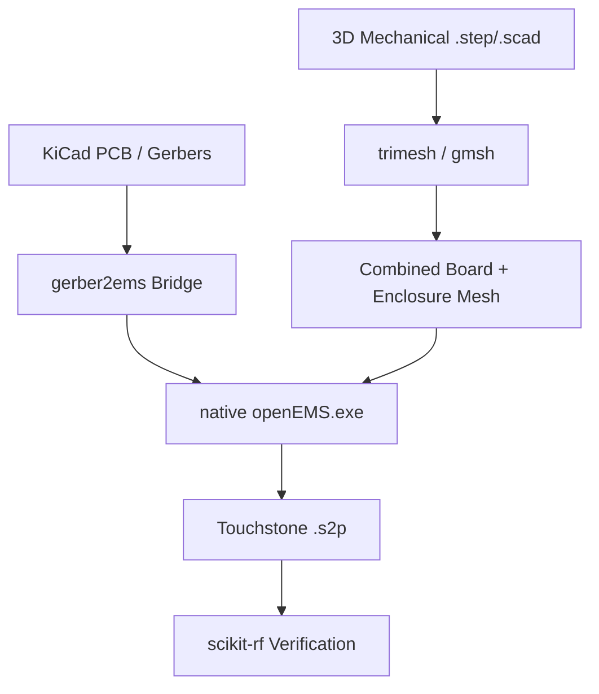

# 04 — Full-Board 3D EM & Mechanical CAD Integration (Native Windows)

This document describes how to execute 3D electromagnetic simulations and mechanical integration on a single native Windows workstation without any Linux, WSL2, or external cluster dependencies.

---

## 1. Local 3D EM Architecture on Windows

This workspace uses a 100% native Windows simulation pipeline:
1. **FDTD Full-Wave Solver**: Native Windows `openEMS.exe` (located in `C:\openEMS\openEMS.exe`) paired with `gerber2ems` inside `.venv`.
2. **Volumetric & Surface Meshing**: Native Windows `gmsh` (4.15.2 via `.venv\Scripts\gmsh.bat` or `.venv\Lib\site-packages\gmsh.py`) and `trimesh` + `shapely`.
3. **Parametric & Commercial EM**: Native Windows `pyaedt` (`ansys.aedt.core`) for direct COM/gRPC integration with local Ansys HFSS or SIwave when installed.



---

## 2. Full-Board & Sub-Circuit 3D FDTD with openEMS

`src/sim/em_openems.py` automates the translation of PCB Gerbers into Yee-grid discretized cells and dispatches simulation to `C:\openEMS\openEMS.exe`:

### Configuration Template
`config/gerber2ems_template.json` specifies the simulation bounding box, frequency sweep, substrate dielectric properties, and port definitions:

```json
{
  "format_version": "1.0",
  "frequency": {
    "min": 1.0e9,
    "max": 5.0e9,
    "f0": 2.45e9
  },
  "mesh": {
    "border_margin_xy_mm": 5.0,
    "border_margin_z_mm": 10.0,
    "cells_per_wavelength": 20
  },
  "stackup": {
    "substrate": {
      "thickness_mm": 0.20,
      "epsilon_r": 4.4,
      "tand": 0.02
    }
  }
}
```

### Python Execution
```python
from src.sim.em_openems import OpenEMSRunner

ems = OpenEMSRunner()

# Runs native Windows openEMS on exported Gerbers
result = ems.run_simulation(
    gerber_dir="build/fab/",
    f_min_ghz=2.40,
    f_max_ghz=2.48,
    dry_run_fallback=True
)

if result.success:
    print(f"Touchstone file: {result.touchstone_path}")
    print(f"Max Return Loss |S11|: {result.metrics.max_s11_db:.2f} dB")
    print(f"Min Insertion Loss |S21|: {result.metrics.min_s21_db:.2f} dB")
```

---

## 3. 3D Volumetric Meshing with Gmsh & Trimesh

To verify physical clearance with mechanical housings or drone frames stored in `hardware/mechanical/` (`.scad`, `.step`, `.stl`):

```python
from src.cad.rf_parametric import RFParametricGenerator

cad = RFParametricGenerator()
filter_comp = cad.generate_stepped_impedance_lpf(
    w_high_mm=0.359,
    l_high_mm=6.861,
    w_low_mm=0.600,
    l_low_mm=1.031
)

# 1. Export 3D Surface STL (for mechanical clearance checks)
cad.export_3d_stl(filter_comp, "build/filter_clearance.stl")

# 2. Export 3D Volume Tetrahedral MSH (for field solving)
cad.export_3d_gmsh(filter_comp, "build/filter_volume.msh")
```

---

## 4. Local Single-GPU Ansys EM Interface (`pyaedt`)

If commercial Ansys electronics software (HFSS, SIwave, Maxwell) is installed on the Windows workstation, `ansys.aedt.core` (`pyaedt`) connects directly via native Windows COM/RPC without any remote bridges:

```python
import ansys.aedt.core as pyaedt

# Connect to local desktop Ansys HFSS session
hfss = pyaedt.Hfss(specified_version="2024.1", non_graphical=True)
print(f"Connected to local Ansys: {hfss.desktop_version}")
```
